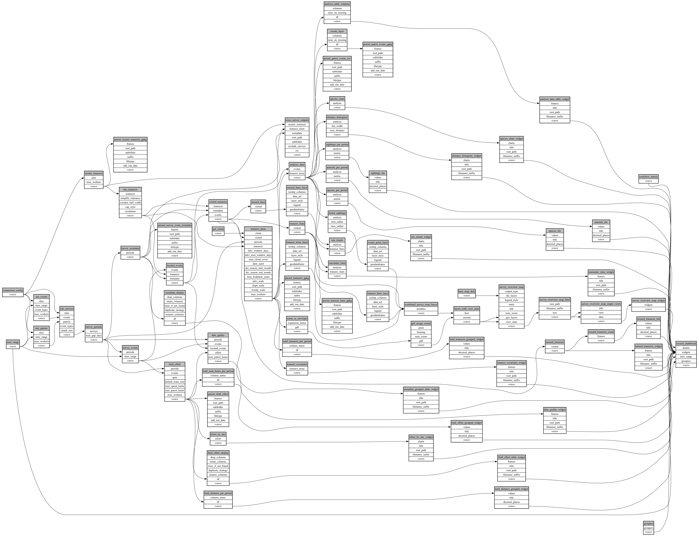

```
# AUTOGENERATED BY ECOSCOPE-WORKFLOWS; see fingerprint in README.md for details

```

```yaml
# fingerprint:
artifacts_sha256_basic: 42cef5e7611658720ec20634553195369268a294e81929c952336c9af2109be2
artifacts_sha256_strict: 2df64a4715686449fff08b65a8d20d16a86cb262bbdc4ec7a121c6aa2dc4743e
installed_requirements:
- channel: https://repo.prefix.dev/ecoscope-workflows/
  name: ecoscope-platform
  version: {version: ==2.28.0}
- channel: https://repo.prefix.dev/ecoscope-workflows-custom/
  name: ecoscope-workflows-ext-custom
  version: {version: ==0.1.5}
- channel: https://repo.prefix.dev/ecoscope-workflows-custom/
  name: ecoscope-workflows-ext-ste
  version: {version: ==0.0.28}
- channel: https://repo.prefix.dev/ecoscope-workflows-custom/
  name: ecoscope-workflows-ext-distance-sample-counts
  version: {version: ==1.2.0}
- channel: conda-forge
  name: pydeck
  version: {version: ==0.9.2}
- channel: conda-forge
  name: opentelemetry-sdk
  version: {version: ==1.45.2}
params_sha256: 21ece7eb607dc5c6c3057eab2565fabf1401965faebc218ce994e3066b42ca49
spec_sha256: d5a2c36a2d6db373a58633f8f014b3f8461e9b08c17ac0ee18300f5e3a33e5ec

```

# ecoscope-workflows-dsc-analysis-workflow


